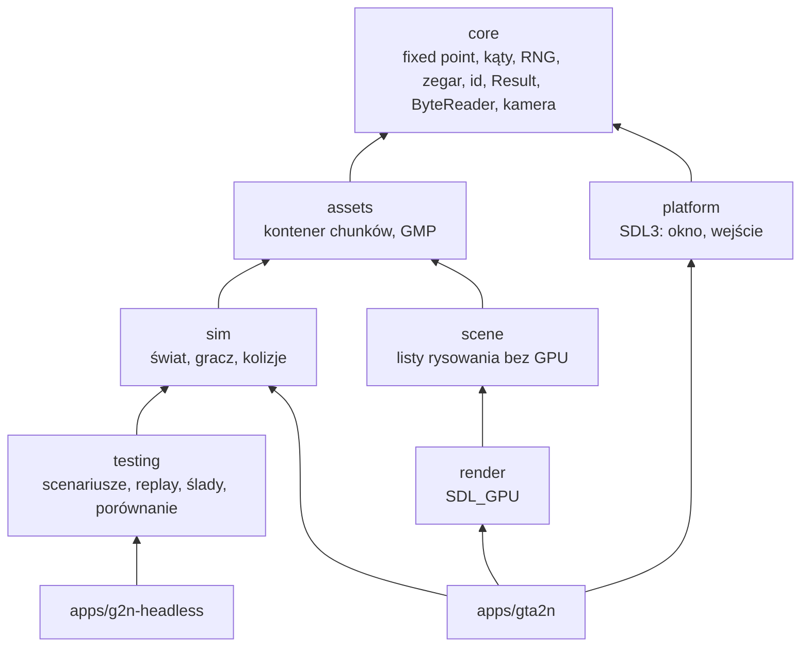

# Architektura silnika gta2-native

Natywna, wieloplatformowa reimplementacja GTA 2 w C++20, oparta na SDL3 i SDL_GPU.
Nie korzysta z OpenGTA2, MonoGame ani .NET. GTA2_RE służy wyłącznie jako materiał do
analizy zachowania oryginału ([reference/gta2re.md](reference/gta2re.md)).

## Cele projektowe

1. **Zgodność z oryginałem** mierzona testami porównawczymi, nie deklarowana.
2. **Deterministyczna symulacja**: to samo wejście, ten sam seed i ta sama liczba ticków dają
   bit w bit identyczny stan na macOS ARM64, Windows x64 i Linux x64.
3. **Symulacja bez okna i GPU**: logika gry kompiluje się i działa bez SDL.
4. **Mało zależności, prosty kod**: brak frameworka ECS i silnika ogólnego przeznaczenia.
   Abstrakcje pojawiają się dopiero wtedy, gdy rozwiązują istniejący problem.

## Moduły i zależności

| Moduł | Katalog | Zależy od | Nie może zależeć od |
|---|---|---|---|
| core | `engine/core` | biblioteka standardowa | czegokolwiek innego |
| assets | `engine/assets` | core | sim, scene, testing, SDL |
| sim | `engine/sim` | core, assets | SDL, GPU, OS, scene, render, platform, testing |
| scene | `engine/scene` | core, assets | SDL, GPU |
| testing | `engine/testing` | core, assets, sim, nlohmann/json | SDL, GPU |
| render | `engine/render` | core, scene, SDL3 | sim |
| platform | `engine/platform` | core, SDL3 | sim, render |
| gta2n | `apps/gta2n` | wszystkie powyższe | — |
| g2n-headless | `apps/g2n-headless` | testing | SDL |

Reguły pilnuje `scripts/ci/check-module-boundaries.sh` (w CI), a CMake linkuje SDL
wyłącznie do `render`, `platform` i aplikacji. Preset `headless` buduje wszystko bez SDL.

## Core

* `Fixed` — Q16.16 na `int32`, mnożenie i dzielenie przez `int64`, przepełnienie zawija się
  (zachowanie zdefiniowane). Symulacja nie używa liczb zmiennoprzecinkowych, więc nie
  zależy od kontrakcji FMA, flag kompilatora ani libm. Konwersja na `double` jest dokładna
  i służy tylko do eksportu i renderu.
* `Angle` — kąt binarny 16-bit (65536 = pełny obrót). `sin`/`cos` korzystają z tablicy
  1024 pozycji liczonej w `consteval` szeregiem Taylora; arytmetyka IEEE przy stałym
  wyrażeniu jest dokładna, więc tablica jest identyczna na każdym kompilatorze.
* `SplitMix64` — w pełni wyspecyfikowany RNG (test na wartościach referencyjnych).
  Cała losowość symulacji pochodzi z instancji z ziarnem ze scenariusza.
* `FixedStepClock`, `FrameAccumulator` — stały krok liczony w ns·Hz (bez błędów
  zaokrągleń), ochrona przed „spiralą śmierci” (limit kroków na klatkę) i współczynnik
  interpolacji dla renderu.
* `HandlePool` / `EntityId` — identyfikatory z generacją (wykrywanie nieaktualnych uchwytów).
* `Result<T>` — błędy jako wartości; parsery i I/O nie rzucają wyjątków przez granice modułów.
* `ByteReader` — odczyt little-endian z kontrolą zakresu i trwałym (sticky) stanem błędu.
* `Camera2D` — rzut ortograficzny z góry (świat: bloki mapy, `y` w dół ekranu).

## Symulacja (`sim`)

`World::step(InputFrame)` przesuwa świat o jeden stały tick. Stan jest w liczbach
stałoprzecinkowych. Obecne reguły ruchu (`PrototypeRules`) i „przechodnie” (`Wanderer`)
to **prototyp**, a nie zachowanie GTA 2. Służą do sprawdzenia całego potoku:
wejście → tick → zrzut stanu → porównanie. Docelowe mechaniki opisuje
[mechanics-matrix.md](mechanics-matrix.md).

Ograniczenia zgodności numerycznej: symulacja jest bit-exact między platformami, bo
używa wyłącznie arytmetyki całkowitej. Wszelkie przyszłe użycie `float`/`double` w `sim`
łamie tę gwarancję i wymaga uzasadnienia oraz tolerancji w scenariuszach.

## Render (`scene` + `render`)

* `scene` buduje listę instancji quadów (`QuadInstance`, 24 B) z mapy i z interpolowanego
  stanu encji. Robi culling do widocznego prostokąta kamery i nie zna GPU, więc ma testy jednostkowe.
* `render` (SDL_GPU) rysuje całą listę **jednym** wywołaniem instancjonowanym. Bufor
  instancji rośnie geometrycznie i jest wielokrotnie używany (`cycle=true`, bez
  alokacji w stanie ustalonym). Pipeline'y są keszowane per format celu.
* Backend: Metal (macOS), Direct3D 12 (Windows), Vulkan (Linux), z możliwością nadpisania
  `--driver`. Shadery: MSL (źródło), SPIR-V (wygenerowane przypiętym glslang 16.6.0,
  świeżość sprawdzana w CI), DXIL/DXBC kompilowane przy buildzie na Windows (`dxc`/`fxc`
  z Windows SDK).
* Render offscreen z odczytem pikseli (`--offscreen WxH --screenshot`) — do testów bez okna.

Kolejne kroki renderu: atlas tekstur ze stylu `.sty`, sprite'y, przezroczystość, ściany 3D
bloków i skosy, oświetlenie, HUD. Batching według tekstury i warstwy (przezroczystość na końcu).

## Platforma i aplikacja

`platform` opakowuje SDL3 w RAII (`SdlRuntime`, `Window`) i udostępnia migawkę wejścia.
Aplikacja `gta2n`:

* symuluje stałe 30 Hz (`FrameAccumulator`, maks. 5 kroków na klatkę),
* renderuje z vsync, interpolując między dwoma ostatnimi stanami (`RenderState` to kopia
  na `float`, która nigdy nie wraca do symulacji),
* steruje kamerą 2D (śledzenie gracza, zoom kółkiem lub klawiszami +/−),
* przy wyjściu zwalnia zasoby w odwrotnej kolejności (RAII) i wypisuje statystyki klatek
  (średnia, p50, p99, maks.), liczbę ticków i szczytowe RSS.

## Testing

Opis: [testing.md](testing.md). Rdzeń: scenariusz JSON → `InputTimeline` → adapter
(`SimulationAdapter`) → `Trace` (JSONL) → `compare_traces` → raport z pierwszą rozbieżnością.
Adapter `engine` uruchamia `g2n::sim::World`. Adapter dla oryginalnego GTA 2 będzie
zasilany danymi z hosta EC2 ([aws/integration.md](aws/integration.md)).

## Zależności zewnętrzne

| Biblioteka | Wersja | Do czego | Przypięcie |
|---|---|---|---|
| SDL3 | 3.4.18 | okno, wejście, SDL_GPU | URL + SHA-256 (zgodny z digestem GitHub) |
| doctest | 2.5.3 | testy jednostkowe | URL + SHA-256 |
| nlohmann/json | 3.12.0 | scenariusze i raporty (tylko moduł `testing`) | URL + SHA-256 |

Zależności pobiera `FetchContent` do `.deps/` (keszowane w CI). `-DG2N_SDL_PROVIDER=system`
pozwala użyć SDL3 z systemu (np. pakiety dystrybucji).
