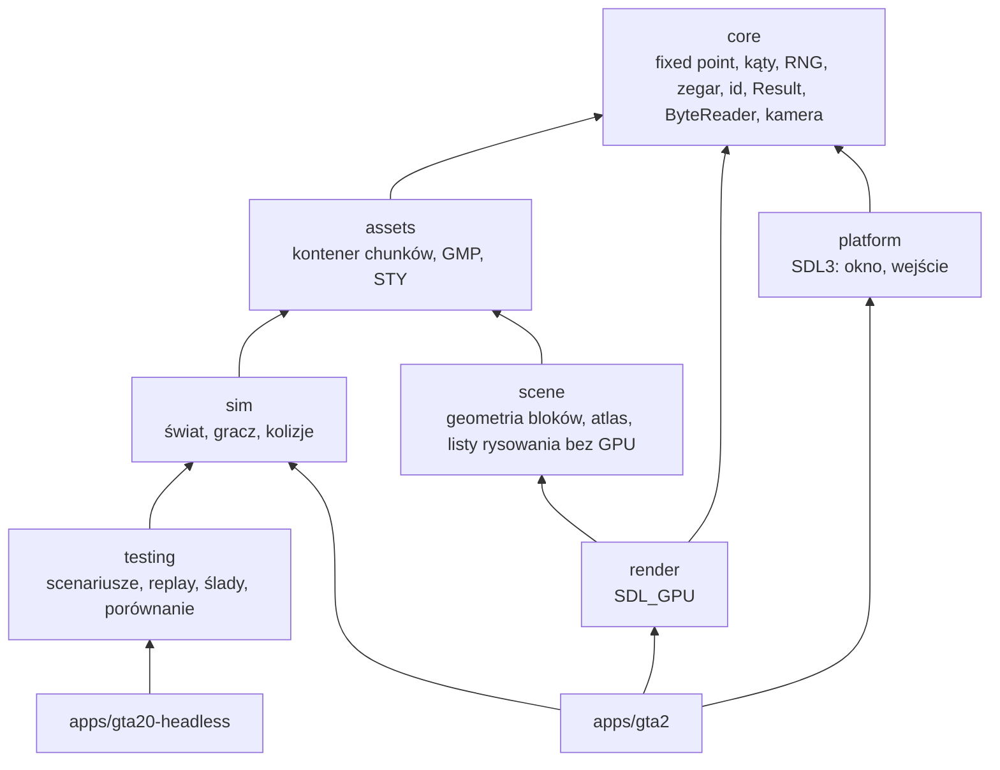

# Architektura silnika GTA2.0

Natywna, wieloplatformowa reimplementacja GTA 2 w C++20, oparta na SDL3 i SDL_GPU.
Nie korzysta z OpenGTA2, MonoGame ani .NET. GTA2_RE służy wyłącznie jako materiał do
analizy zachowania oryginału ([reference/gta2re.md](reference/gta2re.md)).

## Cele projektowe

1. **Zgodność z oryginałem** mierzona testami porównawczymi, nie deklarowana.
2. **Deterministyczna symulacja**: to samo wejście, ten sam seed i ta sama liczba ticków dają
   bit w bit identyczny stan na macOS ARM64, Windows x64 i Linux x64.
3. **Symulacja bez okna i GPU**: logika gry kompiluje się i działa bez SDL.
4. **Mało zależności, prosty kod**: brak frameworka ECS i silnika ogólnego przeznaczenia.
   Abstrakcje pojawiają się dopiero wtedy, gdy rozwiązują istniejący problem.

## Moduły i zależności

Tabela to dokładnie listy dozwolonych krawędzi ze skryptu sprawdzającego. „Zależy od” to
**bezpośrednie** krawędzie; typy dostępne przechodnio (np. `assets::GmpMap` w nagłówkach `scene`
widziany przez `render`) nie dają prawa do własnego `#include` ani linkowania.

| Moduł | Katalog | Może zależeć od (gta20) | SDL3 | Nagłówki API GPU | nlohmann/json | Nie może zależeć od |
|---|---|---|---|---|---|---|
| core | `engine/core` | — (biblioteka standardowa, nagłówki OS) | nie | nie | nie | assets, sim, scene, testing, render, platform |
| assets | `engine/assets` | core | nie | nie | nie | sim, scene, testing, render, platform |
| sim | `engine/sim` | core, assets | nie | nie | nie | scene, testing, render, platform; nagłówki OS i biblioteki spoza gta20 |
| scene | `engine/scene` | core, assets | nie | nie | nie | sim, testing, render, platform |
| testing | `engine/testing` | core, assets, sim | nie | nie | **tak** | scene, render, platform |
| render | `engine/render` | core, scene | **tak** | **tak** | nie | assets (bezpośrednio), sim, testing, platform |
| platform | `engine/platform` | core | **tak** | nie | nie | assets, sim, scene, testing, render |
| gta2 | `apps/gta2` | wszystkie moduły | **tak** | nie | nie | — |
| gta20-headless | `apps/gta20-headless` | core, assets, sim, scene, testing | nie | nie | nie | render, platform |

### Sprawdzanie granic

`scripts/ci/check-module-boundaries.sh [ROOT]` (CI: `native-ci` → „Module boundaries”; CTest:
`scripts.module-boundaries`) odrzuca każdą krawędź spoza tabeli. Krawędzią jest:

* **include** — `#include`/`#import` ścieżki zawierającej `gta20/<moduł>/` (także względnej, np.
  `../../render/include/gta20/render/...`) w plikach C/C++/Objective-C katalogu modułu, łącznie z
  `include/`; należy do modułu, w którego katalogu leży plik;
* **link** — `gta20::<moduł>` albo `gta20_<moduł>` w `target_link_libraries` lub `add_dependencies`;
* **ścieżka nagłówków** — `engine/<moduł>`, `../<moduł>` albo cel modułu (np.
  `$<TARGET_PROPERTY:gta20_sim,…>`) w `target_include_directories`;
* **źródła** — katalog innego modułu w `target_sources`, `add_library`, `add_executable`;
* **opcje** — katalog lub cel innego modułu w `target_compile_options`, `target_link_options`,
  `target_precompile_headers` (np. `-I../sim/include`, `-lgta20_sim`).

Polecenia CMake są sprawdzane we **wszystkich** plikach `CMakeLists.txt` i `*.cmake` projektu
(korzeń, `cmake/`, `engine/`, `apps/`, `tests/`…; bez katalogów builda i `.deps/`), bo każdy z nich
może zmienić dowolny cel. Krawędź należy do modułu, **którego cel jest pierwszym argumentem**
(`gta20_<moduł>`, alias `gta20::<moduł>`, cel aplikacji = nazwa jej katalogu), a nie do katalogu
pliku: `target_link_libraries(gta20_scene PRIVATE gta20::sim)` w `apps/gta2/CMakeLists.txt` czy w
głównym `CMakeLists.txt` to krawędź `scene → sim`. Cele spoza modułów (np. `gta20_unit_tests`)
nie mają reguł; nieznany cel w katalogu modułu podlega regułom tego modułu. Pliki czyta mały lekser
języka CMake: argumenty w cudzysłowie (ze znakami ucieczki), zagnieżdżone nawiasy, argumenty
nawiasowe `[[…]]` / `[=[…]=]` (treść czytana dosłownie), komentarze wierszowe i nawiasowe
`#[[…]]`. Argumenty są dzielone na elementy list CMake (`a;b`, także w cudzysłowie i w argumencie
nawiasowym) i atomy wyrażeń generatora (`$<BUILD_INTERFACE:…>`, zagnieżdżone `$<$<CONFIG:…>:…>`),
więc żadna z tych form nie ukrywa zależności.

Formy, których skrypt nie potrafi przypisać albo przeczytać, są **odrzucane**, nie pomijane:

* nieznany cel `gta20_*`/`gta20::*` jako zależność; aplikacja jako zależność;
* zmienna w argumentach zależności celu modułu (poza `${GTA20_SDL_TARGET}`, a w ścieżkach i opcjach
  poza katalogami `CMAKE_`/`PROJECT_` źródeł i builda);
* cel podany zmienną (argument funkcji lub makra CMake): każda zależność od gta20/SDL/json i
  **każda** zależność podana zmienną, np. `function(link_module target dep)` z
  `target_link_libraries(${target} PRIVATE ${dep})`. Jedyny wyjątek:
  `target_sources(${target} PRIVATE ${output})` w `cmake/EmbedBinary.cmake` (wygenerowany plik
  `.cpp` w katalogu builda);
* `link_libraries` i `include_directories` (zakres katalogu) w plikach wspólnych poza modułami i
  `tests/`;
* właściwości zależności (`LINK_LIBRARIES`, `INCLUDE_DIRECTORIES`, `SOURCES`…) ustawiane przez
  `set_property` / `set_target_properties` na celu modułu — zależności deklaruje się wyłącznie
  poleceniami `target_*`;
* znaki ucieczki CMake (`\`) w argumentach sprawdzanych poleceń (np. `gta20\_sim` to `gta20_sim`);
* cele `ALIAS` inne niż kanoniczne `add_library(gta20::<moduł> ALIAS gta20_<moduł>)` w
  `engine/<moduł>/` (oraz `gta20::json` w `cmake/Dependencies.cmake`), także `add_executable(… ALIAS …)`;
* kod CMake, którego skrypt nie widzi: `cmake_language(...)`; `include()` i `add_subdirectory()`,
  których ścieżka nie rozwiązuje się do skanowanego pliku CMake **w repozytorium**. Rozwiązywane są
  tylko ścieżki względne i `${CMAKE_CURRENT_LIST_DIR}`, `${CMAKE_CURRENT_SOURCE_DIR}` (tylko w
  `CMakeLists.txt`), `${PROJECT_SOURCE_DIR}`, `${CMAKE_SOURCE_DIR}`; nazwa modułu musi być plikiem w
  `cmake/`. Wyjątki dla istniejących pomocników: moduł CMake `FetchContent`, przypięty pomocnik
  doctest w `tests/unit/CMakeLists.txt` i `${cmake_dir}/RenderCapture.cmake` w skrypcie `-P`
  `tests/conformance/rendercheck/CaptureDirTest.cmake`.

Poza zakresem: kod CMake bibliotek zewnętrznych pobieranych do `.deps/` (przypięte URL + SHA-256 w
`cmake/Dependencies.cmake`).

Osobne listy obejmują SDL (`SDL3/…`, `SDL_*.h`, `SDL3::…`, `${GTA20_SDL_TARGET}`), nagłówki API GPU
(`vulkan/`, `d3d12*.h`, `dxgi*.h`, `Metal/`, `GL/`…), nlohmann/json (`nlohmann/…`, `gta20::json`)
oraz — tylko dla `sim` — nagłówki OS (`windows.h`, `unistd.h`, `sys/…`…) i linkowanie czegokolwiek
poza modułami gta20 (także w wyrażeniach generatora). Wiersze `// #include …` i komentarze `#` w
CMake są pomijane. Katalog modułu lub aplikacji bez reguł też jest błędem: nowy moduł trzeba
dopisać do skryptu i tej tabeli.

Testy skryptu: `tests/scripts/check-module-boundaries.test.sh` (CTest
`scripts.module-boundaries-fixtures`, poza Windows). Każdy przypadek kopiuje `CMakeLists.txt`,
`cmake/`, `engine/`, `apps/` i `tests/` do katalogu tymczasowego, dodaje jedną oznaczoną krawędź
**SYNTHETIC** i wymaga dokładnie jednego błędu wskazującego plik i wiersz; obecny graf, minimalne
syntetyczne drzewo z każdą dozwoloną krawędzią, zakomentowane krawędzie i dozwolone odpowiedniki
każdej formy CMake (listy, wyrażenia generatora, argumenty nawiasowe, polecenia na cudzym celu,
opcje) muszą przejść. Pliki
repozytorium nie są modyfikowane (test to sprawdza).

CMake linkuje SDL wyłącznie do `render`, `platform` i `gta2`. Preset `headless` buduje wszystko bez SDL.

## Core

* `Fixed` — Q16.16 na `int32`, mnożenie i dzielenie przez `int64`, przepełnienie zawija się
  (zachowanie zdefiniowane). Symulacja nie używa liczb zmiennoprzecinkowych, więc nie
  zależy od kontrakcji FMA, flag kompilatora ani libm. Konwersja na `double` jest dokładna
  i służy tylko do eksportu i renderu.
* `Angle` — kąt binarny 16-bit (65536 = pełny obrót). `sin`/`cos` korzystają z tablicy
  1024 pozycji liczonej w `consteval` szeregiem Taylora; arytmetyka IEEE przy stałym
  wyrażeniu jest dokładna, więc tablica jest identyczna na każdym kompilatorze.
* `SplitMix64` — w pełni wyspecyfikowany RNG (test na wartościach referencyjnych).
  Cała losowość symulacji pochodzi z instancji z ziarnem ze scenariusza.
* `FixedStepClock`, `FrameAccumulator` — stały krok liczony w ns·Hz (bez błędów
  zaokrągleń), ochrona przed „spiralą śmierci” (limit kroków na klatkę) i współczynnik
  interpolacji dla renderu.
* `HandlePool` / `EntityId` — identyfikatory z generacją (wykrywanie nieaktualnych uchwytów).
* `Result<T>` — błędy jako wartości; parsery i I/O nie rzucają wyjątków przez granice modułów.
* `ByteReader` — odczyt little-endian z kontrolą zakresu i trwałym (sticky) stanem błędu.
* `Camera2D` — rzut ortograficzny z góry (świat: bloki mapy, `y` w dół ekranu).

## Symulacja (`sim`)

`World::step(InputFrame)` przesuwa świat o jeden stały tick. Stan jest w liczbach
stałoprzecinkowych. Obecne reguły ruchu (`PrototypeRules`) i „przechodnie” (`Wanderer`)
to **prototyp**, a nie zachowanie GTA 2. Służą do sprawdzenia całego potoku:
wejście → tick → zrzut stanu → porównanie. Docelowe mechaniki opisuje
[mechanics-matrix.md](mechanics-matrix.md).

Ograniczenia zgodności numerycznej: symulacja jest bit-exact między platformami, bo
używa wyłącznie arytmetyki całkowitej. Wszelkie przyszłe użycie `float`/`double` w `sim`
łamie tę gwarancję i wymaga uzasadnienia oraz tolerancji w scenariuszach.

## Render (`scene` + `render`)

### Stan obecny

* **`QuadInstance` (40 B, bez wypełnienia, `static_assert` w `draw_list.hpp`)** — jedna instancja
  quada, układ zgodny z wejściem wierzchołków GPU:

  | Bajty | Pole | Typ | Atrybut (`renderer.cpp`) |
  |---|---|---|---|
  | 0–7 | `center_x`, `center_y` — środek w jednostkach świata (bloki) | 2 × `float` | 1: `FLOAT2` |
  | 8–15 | `width`, `height` | 2 × `float` | 2: `FLOAT2` |
  | 16–19 | `rotation` — radiany, zgodnie z ruchem wskazówek zegara na ekranie | `float` | 3: `FLOAT` |
  | 20–23 | `r`, `g`, `b`, `a` | 4 × `u8` | 4: `UBYTE4_NORM` |
  | 24–39 | `uv` (`UvRect`: `u0`, `v0`, `u1`, `v1`) — prostokąt w atlasie, znormalizowany | 4 × `float` | 5: `FLOAT4` |

  Atrybut 0 to narożnik quada (`FLOAT2`, osobny bufor wierzchołków z 6 narożnikami dwóch
  trójkątów). Kolor jest mnożony przez teksel; biały slot atlasu daje płaski kolor.
* **Atlas (`scene::TileAtlas`, istnieje)** — tekstura RGBA8 2048 × 2048: siatka 32 × 32 slotów
  64 × 64, slot = numer kafla stylu (`build_tile_atlas(StyStyle)` dekoduje do 1023 kafli; GTA 2
  używa < 992). Slot 1023 jest nieprzezroczysto biały (`kWhiteSlot`) — dla quadów bez tekstury,
  **nie** jest to kafel 1023. `slot_uv` daje prostokąt z wcięciem pół teksela. Bez danych gry
  `make_white_atlas()` (sam biały slot). Aplikacja buduje atlas raz przy starcie (CPU, `scene`) i
  przekazuje piksele do `Renderer::set_atlas`, który tworzy teksturę i wysyła ją jednym przebiegiem
  kopiowania; poprzednia tekstura jest zwalniana po `SDL_WaitForGPUIdle`. Zanim atlas zostanie
  ustawiony, związana jest tekstura 1 × 1 biała. Sampler: najbliższy sąsiad, `CLAMP_TO_EDGE`.
* **Co klatkę** `apps/gta2` (`build_frame`) czyści `DrawList` i od nowa dopisuje: pokrywy
  widocznych komórek wszystkich poziomów, od najniższego (`append_map_textured`; pomija kafel 0 i
  kafle ≥ `tile_count`) albo widok debug kolorów (`append_map`), potem encje (`append_entities`).
  Culling tylko do prostokąta kamery (`Camera2D::visible_world`); `scene` nie zna GPU i ma testy
  jednostkowe.
* **Co klatkę** `render` kopiuje **całą** listę do bufora transferowego (`cycle=true`, bez czekania
  na GPU) i przebiegiem kopiowania do bufora instancji w tym samym buforze poleceń. Oba bufory
  rosną ×2 od 1024 instancji i nie są zmniejszane (bez alokacji w stanie ustalonym). Macierz
  `Camera2D::view_projection` (ortograficzna, z = 0 w shaderach) idzie jako uniform wierzchołków.
  Rysowanie: **jedno** wywołanie instancjonowane (6 wierzchołków × liczba quadów), kolejność listy,
  mieszanie alfa, bez bufora głębi, bez cullingu ścian. Pipeline'y keszowane per format celu
  (2 sloty: swapchain i offscreen RGBA8).
* Backend: Metal (macOS), Direct3D 12 (Windows), Vulkan (Linux), z możliwością nadpisania
  `--driver`. Shadery: MSL (źródło), SPIR-V (wygenerowane przypiętym glslang 16.6.0,
  świeżość sprawdzana w CI), DXIL/DXBC kompilowane przy buildzie na Windows (`dxc`/`fxc`
  z Windows SDK).
* Render offscreen z odczytem pikseli (`--offscreen WxH --screenshot`) — do testów bez okna.
* CPU-owe pomocniki geometrii (`block_geometry.hpp`: pięć ścian bloku; `face_texture.hpp`:
  narożniki tekstury A–D dla obrotu/odbicia) istnieją w `scene`, ale nic ich jeszcze nie rysuje.

### Propozycja: siatka świata i własność zasobów renderu

Stan: **propozycja** (nie zaimplementowana), zgodna z przeglądem architektury Astry z 2026-10-13
(siatki indeksowane świata i osobna kamera świata; `QuadInstance` zostaje dla nakładek i encji;
bez ECS i bez wiązania geometrii z symulacją). Parametry rzutu i reguły widoczności ścian są
nierozstrzygnięte ([specs/world-geometry.md](specs/world-geometry.md), sekcje 4–6), więc
propozycja ustala tylko podział odpowiedzialności, nie zachowanie.

| Co | Właściciel | Tworzone | Życie | Uwagi |
|---|---|---|---|---|
| Atlas kafli (piksele CPU) | `scene` (`TileAtlas`) | raz przy wczytaniu stylu | do zmiany stylu | bez zmian względem dziś |
| Tekstura atlasu, sampler | `render` | `set_atlas` | do następnego `set_atlas` / destruktora | bez zmian |
| Siatka świata CPU (proponowane `scene::WorldMesh`) | `scene` | z `GmpMap` + `tile_count` + `block_face_geometry` + `face_texture_corners`, w paczkach obszarów mapy | **do zmiany mapy, nie co klatkę** | wierzchołki: pozycja w jednostkach bloków (x, y, z), UV atlasu, kolor/odcień; indeksy `u32`; bez typów SDL; testy jednostkowe na mapach syntetycznych |
| Bufory GPU siatki (wierzchołki, indeksy) | `render` | jednorazowe przesłanie siatki z `scene` (uchwyt zwracany aplikacji) | do zwolnienia uchwytu / destruktora | `render` nie czyta `GmpMap` ani nie includuje `assets`; dostaje tylko dane `scene` |
| Bufor głębi, pipeline świata | `render` | przy pierwszym rysowaniu danego celu / rozmiaru | jak pipeline'y dziś (keszowane) | konieczny, gdy pojawi się wysokość (sekcja 6.1 spec) |
| Kamera świata (projekcja zależna od wysokości) | `scene` (bez SDL), obok `Camera2D` z `core` | aplikacja co klatkę | wartość | parametry `K`, `r`, `c` z pomiarów WG-ELEV / WG-PROJ |
| `DrawList` / `QuadInstance` | `scene` → `render` | co klatkę | klatka | encje, HUD, widok debug; nadal przesyłane co klatkę |
| Koordynacja | `apps/gta2` | — | — | wczytuje dane (`assets`), buduje atlas i siatkę (`scene`), przekazuje je raz do `render`; co klatkę tylko kamera i `DrawList` |

Propozycja nie wymaga nowych krawędzi zależności: `scene → assets, core` i `render → scene, core`
są już dozwolone, a skrypt granic odrzuci `render → assets`, `render → sim` i `scene → render`.

Dalsze kroki renderu (po pomiarach z oryginału): ściany bloków, wysokość i projekcja, skosy,
sprite'y, oświetlenie pokryw, HUD. Batching według tekstury i warstwy (przezroczystość na końcu).

## Platforma i aplikacja

`platform` opakowuje SDL3 w RAII (`SdlRuntime`, `Window`) i udostępnia migawkę wejścia.
Aplikacja `gta2`:

* symuluje stałe 30 Hz (`FrameAccumulator`, maks. 5 kroków na klatkę),
* renderuje z vsync, interpolując między dwoma ostatnimi stanami (`RenderState` to kopia
  na `float`, która nigdy nie wraca do symulacji),
* steruje kamerą 2D (śledzenie gracza, zoom kółkiem lub klawiszami +/−),
* przy wyjściu zwalnia zasoby w odwrotnej kolejności (RAII) i wypisuje statystyki klatek
  (średnia, p50, p99, maks.), liczbę ticków i szczytowe RSS.

## Testing

Opis: [testing.md](testing.md). Rdzeń: scenariusz JSON → `InputTimeline` → adapter
(`SimulationAdapter`) → `Trace` (JSONL) → `compare_traces` → raport z pierwszą rozbieżnością.
Adapter `engine` uruchamia `gta20::sim::World`. Adapter dla oryginalnego GTA 2 będzie
zasilany danymi z hosta EC2 ([aws/integration.md](aws/integration.md)).

## Zależności zewnętrzne

| Biblioteka | Wersja | Do czego | Przypięcie |
|---|---|---|---|
| SDL3 | 3.4.18 | okno, wejście, SDL_GPU | URL + SHA-256 (zgodny z digestem GitHub) |
| doctest | 2.5.3 | testy jednostkowe | URL + SHA-256 |
| nlohmann/json | 3.12.0 | scenariusze i raporty (tylko moduł `testing`) | URL + SHA-256 |

Zależności pobiera `FetchContent` do `.deps/` (keszowane w CI). `-DGTA20_SDL_PROVIDER=system`
pozwala użyć SDL3 z systemu (np. pakiety dystrybucji).
