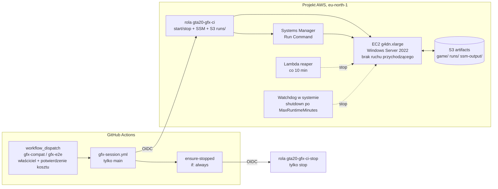

# Testy graficzne oryginalnego GTA 2 na EC2 G4dn

Cel: automatycznie uruchamiać oryginalne GTA 2 (PC 10.5 — wersja referencyjna
[GTA2_RE](https://github.com/CriminalRETeam/gta2_re)) z prawdziwą grafiką,
żeby porównywać je z GTA2.0. **Nie zakładamy, że GTA 2 działa na G4dn** —
najpierw uruchamia się osobny test kompatybilności DirectDraw/Direct3D
(`gfx-compat`), a dopiero po wyniku `COMPATIBLE` włącza się pełną automatyzację
(`gfx-e2e`).

## Architektura



Przebieg jednej sesji (`scripts/ci/ec2-gpu-session.sh`):

1. `resolve` — znajduje dokładnie jedną instancję z tagami `Project=GTA20`, `Purpose=gfx-test`.
2. `start` — uruchamia zatrzymaną instancję i czeka, aż agent SSM będzie `Online`.
3. `upload` — kopiuje `tests/gfx/windows/*` i macierz do `s3://…/runs/<run>/scripts/`.
4. `run` — `AWS-RunPowerShellScript` uruchamia `Invoke-GfxCompat.ps1` jako SYSTEM.
   Bootstrap (`Initialize-GfxHost.ps1`) jest idempotentny; jeśli wymaga restartu,
   zwraca kod 3010 — SSM restartuje maszynę i wznawia komendę.
5. Każdy przypadek testowy działa w **interaktywnej sesji konsoli** użytkownika
   `gta2runner` (autologon + zadanie harmonogramu z `LogonType Interactive`).
   SSM działa w sesji 0, która nie ma widocznego pulpitu, więc gra uruchomiona
   bezpośrednio z SSM niczego by nie wyrenderowała.
6. `collect` — pobiera `summary.json`, `environment.json`, `dxdiag.txt`, zrzuty
   ekranu i logi SSM jako artefakt workflow.
7. `stop` — zatrzymuje instancję (szybka ścieżka), a niezależne zadanie
   `ensure-stopped` robi to ponownie nawet po błędzie, timeoucie lub anulowaniu.

## Zabezpieczenia przed kosztami

| Warstwa | Mechanizm | Działa bez GitHuba? |
|---|---|---|
| System | Zadanie `GTA20-Watchdog` przy każdym starcie: `shutdown /s` po `MaxRuntimeMinutes` (tag, domyślnie 60). `InstanceInitiatedShutdownBehavior=stop`. Instalowane w UserData przy pierwszym starcie. | tak |
| AWS | Lambda `…-reaper` co 10 min zatrzymuje host działający dłużej niż `MaxRuntimeMinutes + 10`. | tak |
| IAM | Rola CI nie może `RunInstances`, `ModifyInstanceAttribute`, `CreateTags`, `TerminateInstances` ani nic w IAM (jawny Deny). Może tylko start/stop istniejącego, otagowanego hosta. Tagu `MaxRuntimeMinutes` nie da się zmienić z CI. | tak |
| AWS | Szablon dopuszcza wyłącznie `g4dn.xlarge` / `g4dn.2xlarge`. Spot jest i tak zablokowany przez SCP projektu. | tak |
| AWS | Budżet miesięczny z alertami e-mail (`infra/aws/create-budget.sh`) + limit wydatków w AWS Settings (właściciel projektu). | tak |
| GitHub + IAM | Zatwierdzenie = ręczne `workflow_dispatch` z wpisanym `cost_confirmation=uruchom-ec2`. Zaufanie OIDC roli sesji przyjmuje wyłącznie: repo `1415959822`, właściciela `12907536`, aktora `12907536`, gałąź `main` i plik `gfx-session.yml`. Środowiska z wymaganymi recenzentami nie są dostępne dla prywatnego repo na planie konta (GitHub zwrócił HTTP 422). | częściowo (warunki zaufania są w AWS) |
| GitHub | `concurrency: ec2-gpu-host` na poziomie workflow (sesja + stop szeregowane razem), `timeout-minutes: 65`, budżet sesji 10–60 min walidowany w skrypcie, `executionTimeout` w SSM. | — |
| GitHub | `ensure-stopped` (`if: always()`) z osobną rolą tylko do zatrzymywania (zaufanie bez warunku aktora). | — |

## Szacunek kosztów (eu-north-1, cennik z AWS Price List API, 2026-10-12)

| Pozycja | Stawka | Kiedy |
|---|---|---|
| g4dn.xlarge Windows on-demand | 0,742 USD/h | tylko gdy działa |
| EBS gp3 60 GiB | 0,0836 USD/GB-mies. ≈ 5,02 USD/mies. | stale, także gdy zatrzymana |
| Publiczny IPv4 | ~0,005 USD/h | tylko gdy działa |
| Lambda reaper, S3, SSM Run Command | w praktyce ~0 | — |

Przykład: `probe` ≈ 15 min ≈ 0,19 USD; `compat` (8 przypadków) ≈ 30–40 min ≈ 0,40–0,50 USD;
pierwszy bootstrap (sterownik + restarty) może dodać 10–15 min.

## Uprawnienia IAM

**`gta20-gfx-ci`** (zaufanie, wszystkie warunki `StringEquals`: `aud=sts.amazonaws.com`, `sub=repo:grzebla/gta2.0:ref:refs/heads/main`, `repository_id=1415959822`, `repository_owner_id=12907536`, `actor_id=12907536`, `job_workflow_ref=grzebla/gta2.0/.github/workflows/gfx-session.yml@refs/heads/main`; sesja ≤ 1 h)

| Akcja | Zasób / warunek |
|---|---|
| `ec2:DescribeInstances`, `ec2:DescribeInstanceStatus`, `ssm:DescribeInstanceInformation`, `ssm:GetCommandInvocation`, `ssm:ListCommand*`, `ssm:CancelCommand` | `*` (brak uprawnień na poziomie zasobu) |
| `ec2:StartInstances`, `ec2:StopInstances` | instancje z tagami `Project=GTA20` i `Purpose=gfx-test` |
| `ssm:SendCommand` | dokument `AWS-RunPowerShellScript` + instancje z tymi tagami |
| `s3:PutObject`, `s3:GetObject` | `runs/*`, `ssm-output/*` |
| `s3:ListBucket` | prefiksy `runs/`, `ssm-output/` |
| **Deny** `ec2:RunInstances`, `ModifyInstanceAttribute`, `CreateTags`, `DeleteTags`, `TerminateInstances`, `iam:*` | `*` |

**`gta20-gfx-ci-stop`** (zaufanie jak wyżej, bez `actor_id`): `ec2:DescribeInstances`, `ssm:CancelCommand`, `ec2:StopInstances` na otagowanym hoście.

**Rola instancji**: `AmazonSSMManagedInstanceCore`; odczyt `runs/*`, `game/*`, `tools/*`; zapis `runs/*/results/*`, `ssm-output/*`; odczyt bucketu sterowników GRID.

**Reaper**: `ec2:DescribeInstances`, `ec2:StopInstances` (warunek na tagi), zapis do własnej grupy logów.

## Ograniczenia projektu AWS wykryte 2026-10-12

| Ustalenie | Skutek | Co trzeba zrobić |
|---|---|---|
| SCP projektu (Free i Paid) zawiera `Deny iam:*Provider*` | nie da się utworzyć dostawcy GitHub OIDC | aktywować advanced features w AWS Settings (decyzja właściciela) |
| Limit „Running On-Demand G and VT instances” w eu-north-1 = **0 vCPU** | G4dn się nie uruchomi | wniosek o limit ≥ 4 vCPU (Service Quotas, kod `L-DB2E81BA`) |
| Plan projektu: **FREE** (100 USD kredytów, wygasa 2027-04-12) | koszty G4dn zużywają kredyty; wniosek o limit GPU może zostać odrzucony | ewentualnie przejście na plan Paid |
| Sterowniki GRID/gaming leżą w bucketach S3 w us-east-1; SCP blokuje podpisane `s3:GetObject` w us-east-1 | podpisane pobranie GRID się nie powiedzie | **Rozwiązane 2026-10-13.** Strategia `grid-public`: anonimowe pobranie przez HTTPS publicznego obiektu `ec2-windows-nvidia-drivers/latest/…_aws_swl.exe` (bez podpisanego wywołania API, więc SCP go nie dotyczy). Plik jest przypięty kluczem, SHA-256 i podpisem Authenticode NVIDIA. GRID 596.86 uruchamia T4 w **WDDM** (Direct3D na GPU). Sterownik data center 581.80 (strategia `url`) instaluje się, ale **odmawia WDDM** (`nvidia-smi -dm 0`: Not Supported), więc zostaje tylko jako fallback. |
| `CloudFormation` w us-east-1 zablokowane, `AWS::Budgets::Budget` niedostępny w eu-north-1 | budżetu nie da się utworzyć szablonem | `infra/aws/create-budget.sh` (API Budgets) |
| Spot zablokowany przez SCP | tylko on-demand | — |

## Test kompatybilności renderowania (`gfx-compat`)

Ustalenia z kodu GTA2_RE (`Source/winmain.cpp`, `Source/registry.cpp`):

* ustawienia ekranu: `HKLM\SOFTWARE\DMA Design Ltd\GTA2\Screen` (32-bitowy widok rejestru → `WOW6432Node`);
* `start_mode`: `0` = okno, `1` = pełny ekran (domyślnie); nieudane okno po cichu przełącza grę na pełny ekran i zapisuje `start_mode=1`;
* pełny ekran 640×480 przy 16 bpp; DLL renderera są w 10.5 zaszyte na sztywno: `d3ddll.dll` (Direct3D) + `dmavideo.dll` (DirectDraw);
* `renderdevice` / `videodevice` wybierają urządzenie (domyślnie 1) — ważne, bo na EC2 obecne są „Microsoft Basic Display Adapter” i T4;
* `do_play_movie=0` pomija filmy Bink.

Macierz (`tests/gfx/compat-matrix.json`): natywny DirectDraw systemu, DDrawCompat v0.7.1 i
dgVoodoo2 v2.87.5 (oba przypięte SHA-256 z GitHub Releases; wrapper bez hasha jest odrzucany)
× okno / pełny ekran × wybór urządzenia.

Werdykty przypadków: `PASS`, `PASS_FELL_BACK_TO_FULLSCREEN`, `FAIL_PROCESS_EXITED`,
`FAIL_NO_VISIBLE_CHANGE`, `FAIL_BLANK_SCREEN`, `FAIL_RENDER_STOPPED`, `ERROR*`.
Kryterium „wyrenderowano” (logika w `tests/gfx/windows/GfxAnalysis.psm1`, testy Pester):
≥ 24 unikalne kolory w próbkowanym zrzucie, ≤ 97% czarnych pikseli **i** zmiana ≥ 25%
pikseli względem zrzutu pulpitu sprzed startu gry (albo zmiana rozdzielczości), a proces
nadal żyje po 30 s. Żywy proces nad niezmienionym pulpitem to `FAIL_NO_VISIBLE_CHANGE`.
Dodatkowo raportowane: `gpuProcessSeen` (czy `gta2.exe` pojawił się w `nvidia-smi`),
sesja, kody wyjścia, błędy z dziennika Application.

Wynik ogólny: `COMPATIBLE` (≥ 1 przypadek `PASS*`) / `INCOMPATIBLE` / `INFRASTRUCTURE_ERROR`
(wszystkie przypadki `ERROR*`) / `PROBE_ONLY`.

Tryb operatora (bez GitHub OIDC): `scripts/aws/run-gfx-compat-local.sh <probe|compat>`
uruchamia tę samą sesję z poświadczeniami AWS CLI operatora i zatrzymuje hosta w `trap`
(patrz [../aws/integration.md](../aws/integration.md)).

Promocja do automatyzacji: ustaw zmienne repozytorium `GFX_E2E_ENABLED=true` i
`GFX_E2E_CASES=<id przypadków PASS>`; `gfx-e2e` ma harmonogram zakomentowany.

## Wdrożenie krok po kroku

Kroki oznaczone 💰 tworzą płatne zasoby — wykonuj je dopiero po świadomej decyzji.

1. AWS Settings: aktywuj advanced features (wymagane przez OIDC), ustaw limit wydatków.
2. Service Quotas (eu-north-1): `Running On-Demand G and VT instances` → 4.
3. Budżet: `infra/aws/create-budget.sh <e-mail> 15`
4. 💰 Stos hosta (instancja startuje od razu; watchdog wyłączy ją po 60 min):

   ```bash
   aws cloudformation deploy --region eu-north-1 --stack-name gta20-gfx \
     --template-file infra/aws/gfx-test-stack.yaml --capabilities CAPABILITY_IAM \
     --parameter-overrides VpcId=vpc-012515c9ad46fee92 SubnetId=<subnet domyślnego VPC>
   ```

5. Stos OIDC (bezpłatny):

   ```bash
   aws cloudformation deploy --region eu-north-1 --stack-name gta20-github-oidc \
     --template-file infra/aws/github-oidc.yaml --capabilities CAPABILITY_NAMED_IAM \
     --parameter-overrides ArtifactsBucketName=gta20-gfx-artifacts-<account-id>
   ```

6. Gra: spakuj własną instalację GTA 2 10.5 do zip, wgraj do
   `s3://gta20-gfx-artifacts-<account-id>/game/gta2-10.5.zip`, wpisz jej SHA-256 do
   `game.sha256` w macierzy. Plików gry nie commituj (`.gitignore`).
7. GitHub: zmienne repozytorium `AWS_REGION`, `GFX_BUCKET`, `AWS_GFX_ROLE_ARN`,
   `AWS_GFX_STOP_ROLE_ARN` (ustawione 2026-10-12; ARN-y są deterministyczne i zaczną
   działać po wdrożeniu stosu OIDC). Środowisk nie używamy.
8. 💰 `gfx-compat` z `mode=probe` → sprawdź `environment.json` (sterownik, sesja interaktywna).
9. Jeśli `driver.strategy` = `none`: uzupełnij `driver.url` + `driver.sha256` w macierzy
   i uruchom ponownie probe — bootstrap wykryje zmianę konfiguracji sterownika i spróbuje jeszcze raz.
10. 💰 `gfx-compat` z `mode=compat` → przy `COMPATIBLE` przejdź do promocji `gfx-e2e`.

Sprzątanie: `aws cloudformation delete-stack` dla obu stosów; bucket artefaktów ma
`DeletionPolicy: Retain` (usuń go ręcznie, gdy nie będzie potrzebny).

## Lekcje z pierwszych przebiegów na EC2 (2026-10-13)

- **Restart przez agenta SSM (`exit 3010`) zawiesza się na tym hoście** (powtórzone dwukrotnie; w
  dzienniku zdarzeń nie ma nawet początku zamykania). Bootstrap kończy się więc kodem **194**
  („wymagany restart”), a `ec2-gpu-session.sh run` restartuje instancję przez `ec2 reboot-instances`,
  czeka na ponowny ping agenta SSM i wysyła polecenie jeszcze raz (maksymalnie 3 restarty).
- **Zatrzymanie może zawisnąć w stanie `stopping`** (sterownik data center w TCC; zawieszenie już po
  przejściu jądra w tryb zamykania). `ec2-gpu-session.sh stop` po `STOP_FORCE_AFTER_S` (240 s)
  wymusza zatrzymanie (`--force`).
- `nvidia-smi` zwraca 0 także wtedy, gdy odmawia zmiany modelu sterownika. Bootstrap ufa tylko
  odczytanemu potem `driver_model.pending`.
- Zimny start z sesją autologowania `gta2runner` działa (SSM online po ok. 2 min).

### Stan środowiska po weryfikacji 2026-10-13: **GTA 2 renderuje się na T4**

- Konfiguracja działająca: GTA 2 **9.6** (samodzielne `gta2.exe`) z wrapperem **DDrawCompat 0.7.1**
  (`ddrawcompat-window` i `ddrawcompat-fullscreen` = PASS). Recenzja zrzutu potwierdziła
  oryginalne menu główne: logo GTA2, „PLAY / OPTIONS / QUIT”, „GTA2 V9.6”, logo Rockstar;
  kolory i proporcje poprawne.
- Bez wrappera gra zgłasza „Videomode 16x16x16 is not available”: sterownik nie wystawia
  16-bitowych trybów DirectDraw, które DDrawCompat emuluje. dgVoodoo2: brak obrazu (do zbadania).
- Warunki konieczne, ustawiane przez bootstrap:
  1. sterownik GRID (WDDM);
  2. **DirectPlay** włączony (gta2.exe importuje `DPLAYX.dll`; bez niego loader kończy start
     błędem 0xc0000022);
  3. **jeden ekran**: Basic Display Adapter wyłączony, gdy T4 działa w WDDM (przy dwóch
     adapterach `dmavideo.dll` padał z 0xc0000005);
  4. katalog `player\` (zapisy; rozpakowane archiwum nie zawiera pustych katalogów);
  5. tryb nienadzorowany (`ErrorMode=2`, WER bez UI).
- Wydanie **10.5 z dystrybucji Freeloader** (`freeloader.dat` uruchamiany jako `gta2.exe`) nie
  startuje (0xc0000022), bo oczekuje swojego launchera. Do testów służy 9.6.
- Harness: każdy przypadek zaczyna od pustego katalogu i świeżych ustawień ekranu. Okno
  dialogowe gry daje werdykt `FAIL_GAME_DIALOG` z treścią (wcześniej czarny ekran z oknem
  błędu potrafił dać fałszywy PASS).
- Koszt dnia testów: ok. 3,5 h pracy instancji (ok. 2,6 USD) i ok. 5 USD/mies. za dysk.

### Tryb `capture` i przebiegi zamawiane przez agentów (2026-10-13)

- `capture` uruchamia jeden scenariusz z `tests/gfx/scenarios/<id>.json`: wrapper, ustawienia
  ekranu, czas, momenty zrzutów i skryptowane klawisze. Klawisze idą przez `SendInput` jako
  kody skanowania (DirectInput czyta kody skanowania, nie komunikaty okna) do okna gry; wynik
  zapisuje `inputsSent`. Scenariusze są wyłącznie danymi: host nie wykonuje z nich kodu.
- Przykłady: `frontend-menu` (menu bez wejścia), `frontend-walk` (ENTER i strzałki w menu).
- Lokalnie: `CONFIRM=uruchom-ec2 scripts/aws/run-gfx-compat-local.sh capture frontend-walk 45`.
- Agenci zamawiają przebiegi przez Orchestrator (`gfx_requests`); limity właściciela: 45 min na
  przebieg, 3 przebiegi dziennie, 10 USD miesięcznie. Szczegóły:
  `tools/orchestrator/README.md`, sekcja „Host testowy EC2”.
- Wymaga ważnej sesji `aws login` na Macu z Orchestratorem; po jej wygaśnięciu przebiegi czekają,
  a Orchestrator pyta właściciela.

### Pierwszy przebieg `capture` zlecony przez Astrę (2026-10-13) i poprawki

- `m1-downtown-baseline` (job 1, ok. 0,17 USD): gra uruchomiła się na pełnym ekranie (DDrawCompat
  skaluje 640x480 do 1280x800 na monitorze głównym; T4 ma dwa wirtualne ekrany, razem 2304x800).
  Menu główne zostało bez zmian przez 120 s mimo trzech ENTER: wejście `scancode` nie dotarło do
  gry albo gra go nie odczytała.
- **D1:** werdykt `FAIL_GAME_DIALOG` był fałszywy. `$x = if (...) { @(...) }` rozwija pustą tablicę do
  `$null`, a `@($null).Count` to 1. Naprawione w runnerze i w `Get-CaseVerdict`; test Pestera.
- Diagnostyka każdego klawisza (`result.inputsSent`): metoda, okno pierwszoplanowe przed i w chwili
  wysłania (czy należy do gry), wynik `SetForegroundWindow`, wynik i błąd `SendInput`/`PostMessage`,
  dostęp do pulpitu wejściowego, `IsHungAppWindow`, czas CPU gry i zrzut ekranu 1,5 s po klawiszu
  (`key-<s>-<klawisz>-<metoda>.png`). To dowód pośredni, nie dowód odczytania przez grę.
- Metoda wstrzykiwania jest ustawieniem właściciela w macierzy (`input.method`): `scancode`, `vk`,
  `postmessage`, `activate-scancode` albo `cycle` (klawisz i używa metody i mod 4, do diagnozy).
- `summary.json` zapisuje `harnessRevision` (commit skryptów wysłanych na hosta, `-dirty` przy
  lokalnych zmianach) i `inputMethod`; Orchestrator pokazuje je agentom przy wynikach.
- Przebieg diagnostyczny `cycle` (job 2, `frontend-walk`, harness `c05b588`): werdykt PASS (D1
  naprawione). Wszystkie cztery metody wysłały klawisze, okno gry miało fokus, pulpit wejściowy był
  dostępny, gra nie wisiała i zużywała CPU, ale zrzut ekranu nie zmienił się ani razu. Dwie
  hipotezy: gra ignoruje wstrzyknięte wejście albo zrzut GDI pokazuje zamrożoną klatkę
  pełnoekranowej powierzchni. Dlatego każda klatka ma teraz także zrzut samego okna gry
  (`PrintWindow`, `*-window.png`, `windowCapture`), a logi gry i wrappera z czasu przypadku trafiają
  do `game-logs/`.

### Sterowanie oryginałem: proxy DirectInput (2026-10-13)

**Problem.** Na hoście EC2 prawdziwy DirectInput nigdy nie zgłasza wciśniętego klawisza. Nie
pomaga żadna metoda na poziomie Windows: `SendInput` z kodem skanowania lub wirtualnym klawiszem,
`PostMessage`, `AttachThreadInput` z fokusem ani `WM_ACTIVATE`/`WM_SETFOCUS`. Okno gry ma przy
tym fokus i aktywność (`GetGUIThreadInfo`), pulpit wejściowy jest dostępny, a `Acquire` się
udaje. Najpewniej to skutek maszyny wirtualnej bez urządzenia klawiatury.

**Rozwiązanie.** Własne proxy `dinput8.dll` (`tests/gfx/windows/inject/dinput8_proxy.c`).
GTA 2 9.6 importuje DINPUT8, więc biblioteka w katalogu gry przejmuje `DirectInput8Create` i
przekazuje wszystko do systemowego DirectInput. Dla klawiatury systemowej:
- loguje, co robi gra (`gta20-dinput.log` w `game-logs/`);
- dokłada klawisze ze skryptu (`gta20-input.txt`, czasy w ms od załadowania) w obu ścieżkach
  odczytu gry: `GetDeviceState` w menu i buforowanym `GetDeviceData` w rozgrywce.

Host kompiluje proxy ze źródła przypiętym `zig` (URL + SHA-256 w `compat-matrix.json`, wynik w
pamięci podręcznej według skrótu źródła), więc w repozytorium nie ma binarki. Po każdym
przypadku runner usuwa proxy z katalogu gry, dopiero gdy proces gry się zakończy.

**Zweryfikowane (przebiegi `mcp-20261013-g`/`-i`):**
- menu: ENTER → ekran gracza, DOWN → zmiana pozycji, ENTER → edycja nazwy, ESC → powrót;
  każde naciśnięcie daje dokładnie jedno przejście;
- Downtown (`skip_frontend`): UP prowadzi gracza do kościoła „Jesus Saves” (gra odpowiada
  skryptem punktu zapisu), LEFT obraca postać, kamera podąża.

**Inne ustalenia:**
- Opcje debugowe gry (`debug` w scenariuszu, klucz rejestru `Debug`): `skip_frontend` z
  `mapname`/`stylename`/`scriptname` startuje prosto w mapie.
- Menu po ok. 60 s bez klawisza samo uruchamia demo, co przydaje się jako test, czy pętla
  menu działa.
- **Otwarte:** przy starcie przez `skip_frontend` Downtown nie ma pieszych ani ruchu ulicznego;
  w demie z menu są.

