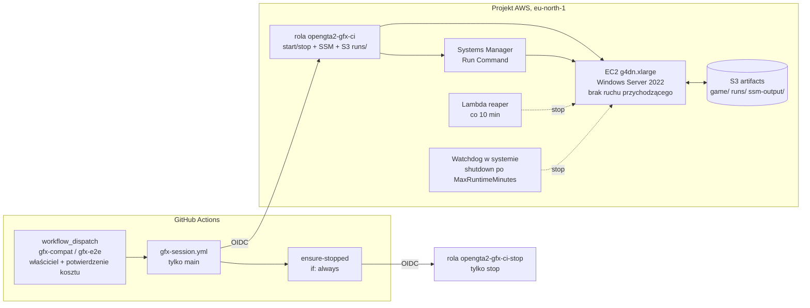

# Testy graficzne oryginalnego GTA 2 na EC2 G4dn

Cel: automatycznie uruchamiać oryginalne GTA 2 (PC 10.5 — wersja referencyjna
[GTA2_RE](https://github.com/CriminalRETeam/gta2_re)) z prawdziwą grafiką,
żeby porównywać je z OpenGTA2. **Nie zakładamy, że GTA 2 działa na G4dn** —
najpierw uruchamia się osobny test kompatybilności DirectDraw/Direct3D
(`gfx-compat`), a dopiero po wyniku `COMPATIBLE` włącza się pełną automatyzację
(`gfx-e2e`).

## Architektura



Przebieg jednej sesji (`scripts/ci/ec2-gpu-session.sh`):

1. `resolve` — znajduje dokładnie jedną instancję z tagami `Project=OpenGTA2`, `Purpose=gfx-test`.
2. `start` — uruchamia zatrzymaną instancję i czeka, aż agent SSM będzie `Online`.
3. `upload` — kopiuje `tests/gfx/windows/*` i macierz do `s3://…/runs/<run>/scripts/`.
4. `run` — `AWS-RunPowerShellScript` uruchamia `Invoke-GfxCompat.ps1` jako SYSTEM.
   Bootstrap (`Initialize-GfxHost.ps1`) jest idempotentny; jeśli wymaga restartu,
   zwraca kod 3010 — SSM restartuje maszynę i wznawia komendę.
5. Każdy przypadek testowy działa w **interaktywnej sesji konsoli** użytkownika
   `gta2runner` (autologon + zadanie harmonogramu z `LogonType Interactive`).
   SSM działa w sesji 0, która nie ma widocznego pulpitu, więc gra uruchomiona
   bezpośrednio z SSM niczego by nie wyrenderowała.
6. `collect` — pobiera `summary.json`, `environment.json`, `dxdiag.txt`, zrzuty
   ekranu i logi SSM jako artefakt workflow.
7. `stop` — zatrzymuje instancję (szybka ścieżka), a niezależne zadanie
   `ensure-stopped` robi to ponownie nawet po błędzie, timeoucie lub anulowaniu.

## Zabezpieczenia przed kosztami

| Warstwa | Mechanizm | Działa bez GitHuba? |
|---|---|---|
| System | Zadanie `OpenGTA2-Watchdog` przy każdym starcie: `shutdown /s` po `MaxRuntimeMinutes` (tag, domyślnie 60). `InstanceInitiatedShutdownBehavior=stop`. Instalowane w UserData przy pierwszym starcie. | tak |
| AWS | Lambda `…-reaper` co 10 min zatrzymuje host działający dłużej niż `MaxRuntimeMinutes + 10`. | tak |
| IAM | Rola CI nie może `RunInstances`, `ModifyInstanceAttribute`, `CreateTags`, `TerminateInstances` ani nic w IAM (jawny Deny). Może tylko start/stop istniejącego, otagowanego hosta. Tagu `MaxRuntimeMinutes` nie da się zmienić z CI. | tak |
| AWS | Szablon dopuszcza wyłącznie `g4dn.xlarge` / `g4dn.2xlarge`. Spot jest i tak zablokowany przez SCP projektu. | tak |
| AWS | Budżet miesięczny z alertami e-mail (`infra/aws/create-budget.sh`) + limit wydatków w AWS Settings (właściciel projektu). | tak |
| GitHub + IAM | Zatwierdzenie = ręczne `workflow_dispatch` z wpisanym `cost_confirmation=uruchom-ec2`. Zaufanie OIDC roli sesji przyjmuje wyłącznie: repo `1415959822`, właściciela `12907536`, aktora `12907536`, gałąź `main` i plik `gfx-session.yml`. Środowiska z wymaganymi recenzentami nie są dostępne dla prywatnego repo na planie konta (GitHub zwrócił HTTP 422). | częściowo (warunki zaufania są w AWS) |
| GitHub | `concurrency: ec2-gpu-host` na poziomie workflow (sesja + stop szeregowane razem), `timeout-minutes: 65`, budżet sesji 10–60 min walidowany w skrypcie, `executionTimeout` w SSM. | — |
| GitHub | `ensure-stopped` (`if: always()`) z osobną rolą tylko do zatrzymywania (zaufanie bez warunku aktora). | — |

## Szacunek kosztów (eu-north-1, cennik z AWS Price List API, 2026-10-12)

| Pozycja | Stawka | Kiedy |
|---|---|---|
| g4dn.xlarge Windows on-demand | 0,742 USD/h | tylko gdy działa |
| EBS gp3 60 GiB | 0,0836 USD/GB-mies. ≈ 5,02 USD/mies. | stale, także gdy zatrzymana |
| Publiczny IPv4 | ~0,005 USD/h | tylko gdy działa |
| Lambda reaper, S3, SSM Run Command | w praktyce ~0 | — |

Przykład: `probe` ≈ 15 min ≈ 0,19 USD; `compat` (8 przypadków) ≈ 30–40 min ≈ 0,40–0,50 USD;
pierwszy bootstrap (sterownik + restarty) może dodać 10–15 min.

## Uprawnienia IAM

**`opengta2-gfx-ci`** (zaufanie, wszystkie warunki `StringEquals`: `aud=sts.amazonaws.com`, `sub=repo:grzebla/OpenGTA2:ref:refs/heads/main`, `repository_id=1415959822`, `repository_owner_id=12907536`, `actor_id=12907536`, `job_workflow_ref=grzebla/OpenGTA2/.github/workflows/gfx-session.yml@refs/heads/main`; sesja ≤ 1 h)

| Akcja | Zasób / warunek |
|---|---|
| `ec2:DescribeInstances`, `ec2:DescribeInstanceStatus`, `ssm:DescribeInstanceInformation`, `ssm:GetCommandInvocation`, `ssm:ListCommand*`, `ssm:CancelCommand` | `*` (brak uprawnień na poziomie zasobu) |
| `ec2:StartInstances`, `ec2:StopInstances` | instancje z tagami `Project=OpenGTA2` i `Purpose=gfx-test` |
| `ssm:SendCommand` | dokument `AWS-RunPowerShellScript` + instancje z tymi tagami |
| `s3:PutObject`, `s3:GetObject` | `runs/*`, `ssm-output/*` |
| `s3:ListBucket` | prefiksy `runs/`, `ssm-output/` |
| **Deny** `ec2:RunInstances`, `ModifyInstanceAttribute`, `CreateTags`, `DeleteTags`, `TerminateInstances`, `iam:*` | `*` |

**`opengta2-gfx-ci-stop`** (zaufanie jak wyżej, bez `actor_id`): `ec2:DescribeInstances`, `ssm:CancelCommand`, `ec2:StopInstances` na otagowanym hoście.

**Rola instancji**: `AmazonSSMManagedInstanceCore`; odczyt `runs/*`, `game/*`, `tools/*`; zapis `runs/*/results/*`, `ssm-output/*`; odczyt bucketu sterowników GRID.

**Reaper**: `ec2:DescribeInstances`, `ec2:StopInstances` (warunek na tagi), zapis do własnej grupy logów.

## Ograniczenia projektu AWS wykryte 2026-10-12

| Ustalenie | Skutek | Co trzeba zrobić |
|---|---|---|
| SCP projektu (Free i Paid) zawiera `Deny iam:*Provider*` | nie da się utworzyć dostawcy GitHub OIDC | aktywować advanced features w AWS Settings (decyzja właściciela) |
| Limit „Running On-Demand G and VT instances” w eu-north-1 = **0 vCPU** | G4dn się nie uruchomi | wniosek o limit ≥ 4 vCPU (Service Quotas, kod `L-DB2E81BA`) |
| Plan projektu: **FREE** (100 USD kredytów, wygasa 2027-04-12) | koszty G4dn zużywają kredyty; wniosek o limit GPU może zostać odrzucony | ewentualnie przejście na plan Paid |
| Sterowniki GRID/gaming leżą w bucketach S3 w us-east-1; SCP `RegionFloor`/`UsEast1Partitional` nie przepuszcza `s3:GetObject` w us-east-1 | instalacja GRID prawdopodobnie się nie powiedzie | strategia `url`: publiczny sterownik NVIDIA 581.80 (R580) dla Windows Server 2022/2025 z SHA-256 i weryfikacją podpisu Authenticode; sterowniki Tesla startują w TCC, więc bootstrap jednorazowo przełącza T4 na WDDM (skuteczność potwierdzi `probe`) |
| `CloudFormation` w us-east-1 zablokowane, `AWS::Budgets::Budget` niedostępny w eu-north-1 | budżetu nie da się utworzyć szablonem | `infra/aws/create-budget.sh` (API Budgets) |
| Spot zablokowany przez SCP | tylko on-demand | — |

## Test kompatybilności renderowania (`gfx-compat`)

Ustalenia z kodu GTA2_RE (`Source/winmain.cpp`, `Source/registry.cpp`):

* ustawienia ekranu: `HKLM\SOFTWARE\DMA Design Ltd\GTA2\Screen` (32-bitowy widok rejestru → `WOW6432Node`);
* `start_mode`: `0` = okno, `1` = pełny ekran (domyślnie); nieudane okno po cichu przełącza grę na pełny ekran i zapisuje `start_mode=1`;
* pełny ekran 640×480 przy 16 bpp; DLL renderera są w 10.5 zaszyte na sztywno: `d3ddll.dll` (Direct3D) + `dmavideo.dll` (DirectDraw);
* `renderdevice` / `videodevice` wybierają urządzenie (domyślnie 1) — ważne, bo na EC2 obecne są „Microsoft Basic Display Adapter” i T4;
* `do_play_movie=0` pomija filmy Bink.

Macierz (`tests/gfx/compat-matrix.json`): natywny DirectDraw systemu, DDrawCompat v0.7.1 i
dgVoodoo2 v2.87.5 (oba przypięte SHA-256 z GitHub Releases; wrapper bez hasha jest odrzucany)
× okno / pełny ekran × wybór urządzenia.

Werdykty przypadków: `PASS`, `PASS_FELL_BACK_TO_FULLSCREEN`, `FAIL_PROCESS_EXITED`,
`FAIL_NO_VISIBLE_CHANGE`, `FAIL_BLANK_SCREEN`, `FAIL_RENDER_STOPPED`, `ERROR*`.
Kryterium „wyrenderowano” (logika w `tests/gfx/windows/GfxAnalysis.psm1`, testy Pester):
≥ 24 unikalne kolory w próbkowanym zrzucie, ≤ 97% czarnych pikseli **i** zmiana ≥ 25%
pikseli względem zrzutu pulpitu sprzed startu gry (albo zmiana rozdzielczości), a proces
nadal żyje po 30 s. Żywy proces nad niezmienionym pulpitem to `FAIL_NO_VISIBLE_CHANGE`.
Dodatkowo raportowane: `gpuProcessSeen` (czy `gta2.exe` pojawił się w `nvidia-smi`),
sesja, kody wyjścia, błędy z dziennika Application.

Wynik ogólny: `COMPATIBLE` (≥ 1 przypadek `PASS*`) / `INCOMPATIBLE` / `INFRASTRUCTURE_ERROR`
(wszystkie przypadki `ERROR*`) / `PROBE_ONLY`.

Tryb operatora (bez GitHub OIDC): `scripts/aws/run-gfx-compat-local.sh <probe|compat>`
uruchamia tę samą sesję z poświadczeniami AWS CLI operatora i zatrzymuje hosta w `trap`
(patrz [../aws/integration.md](../aws/integration.md)).

Promocja do automatyzacji: ustaw zmienne repozytorium `GFX_E2E_ENABLED=true` i
`GFX_E2E_CASES=<id przypadków PASS>`; `gfx-e2e` ma harmonogram zakomentowany.

## Wdrożenie krok po kroku

Kroki oznaczone 💰 tworzą płatne zasoby — wykonuj je dopiero po świadomej decyzji.

1. AWS Settings: aktywuj advanced features (wymagane przez OIDC), ustaw limit wydatków.
2. Service Quotas (eu-north-1): `Running On-Demand G and VT instances` → 4.
3. Budżet: `infra/aws/create-budget.sh <e-mail> 15`
4. 💰 Stos hosta (instancja startuje od razu; watchdog wyłączy ją po 60 min):

   ```bash
   aws cloudformation deploy --region eu-north-1 --stack-name opengta2-gfx \
     --template-file infra/aws/gfx-test-stack.yaml --capabilities CAPABILITY_IAM \
     --parameter-overrides VpcId=vpc-012515c9ad46fee92 SubnetId=<subnet domyślnego VPC>
   ```

5. Stos OIDC (bezpłatny):

   ```bash
   aws cloudformation deploy --region eu-north-1 --stack-name opengta2-github-oidc \
     --template-file infra/aws/github-oidc.yaml --capabilities CAPABILITY_NAMED_IAM \
     --parameter-overrides ArtifactsBucketName=opengta2-gfx-artifacts-<account-id>
   ```

6. Gra: spakuj własną instalację GTA 2 10.5 do zip, wgraj do
   `s3://opengta2-gfx-artifacts-<account-id>/game/gta2-10.5.zip`, wpisz jej SHA-256 do
   `game.sha256` w macierzy. Plików gry nie commituj (`.gitignore`).
7. GitHub: zmienne repozytorium `AWS_REGION`, `GFX_BUCKET`, `AWS_GFX_ROLE_ARN`,
   `AWS_GFX_STOP_ROLE_ARN` (ustawione 2026-10-12; ARN-y są deterministyczne i zaczną
   działać po wdrożeniu stosu OIDC). Środowisk nie używamy.
8. 💰 `gfx-compat` z `mode=probe` → sprawdź `environment.json` (sterownik, sesja interaktywna).
9. Jeśli `driver.strategy` = `none`: uzupełnij `driver.url` + `driver.sha256` w macierzy
   i uruchom ponownie probe — bootstrap wykryje zmianę konfiguracji sterownika i spróbuje jeszcze raz.
10. 💰 `gfx-compat` z `mode=compat` → przy `COMPATIBLE` przejdź do promocji `gfx-e2e`.

Sprzątanie: `aws cloudformation delete-stack` dla obu stosów; bucket artefaktów ma
`DeletionPolicy: Retain` (usuń go ręcznie, gdy nie będzie potrzebny).
