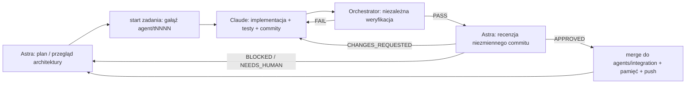

# GTA2.0 Orchestrator

Lokalny, niezależny proces, który prowadzi rozwój GTA2.0 przez dwa agenty:

| Rola | Agent | Uprawnienia |
|---|---|---|
| **Astra** — Tech Lead, planista, recenzent | `gpt-6-astra` przez `codex exec` | sandbox **read-only**, bez zatwierdzeń, ignoruje `~/.codex/config.toml` (tam jest `danger-full-access`) |
| **Claude** — developer | Claude Code `claude -p` | `dontAsk` + jawne reguły allow/deny, sandbox Basha (Seatbelt: zapis tylko w worktree, sieć tylko z allowlisty), bez MCP i ustawień użytkownika; **nigdy** `--dangerously-skip-permissions` |
| **Gatekeeper** — ostateczne review i merge PR do `main` | `gpt-6.1-sol` przez `codex exec` (inny model niż Astra, dla niezależności) | sandbox **read-only**; scala wyłącznie przez Orchestrator, po twardych bramkach |
| **Orchestrator** | Python 3.9+, wyłącznie biblioteka standardowa | scala zadania do gałęzi integracyjnej, wysyła ją na GitHub (bez force push) i wykonuje merge zatwierdzony przez Gatekeepera |

## Pętla



- Każdy krok to co najwyżej jedno wywołanie agenta, zakończone transakcją w SQLite. Następny
  krok rusza dopiero po zapisie stanu.
- Statusy zadań: `READY → IN_PROGRESS → VERIFYING → IN_REVIEW → DONE`, plus
  `CHANGES_REQUESTED`, `BLOCKED`, `NEEDS_HUMAN`, `CANCELLED`.
- Stan pętli: `RUNNING`, `PAUSED`, `WAITING_FOR_QUOTA`, `WAITING`, `HALTED`, `STOPPED`.
- **Weryfikacja** nie ufa raportowi Claude. Sprawdza:
  - czysty worktree i nowe commity;
  - brak zmian w ścieżkach chronionych, plików gry i binarek;
  - brak plików > 5 MB i sekretów w dodanych liniach;
  - czy diff różni się od poprzedniej próby;
  - build i testy (`cmake --preset debug`, build, `ctest`) z `GTA20_GAME_DIR`;
  - te same kroki co `infra-lint`: shellcheck i offline'owe testy Bash (atrapa `aws`);
  - clang-tidy po całym kodzie, jak w CI (na macOS z sysroot SDK, bo clang-tidy z pip sam nie
    znajduje nagłówków C++ i zgłasza fałszywe błędy);
  - preset `asan` (ASan + UBSan): build i pełny CTest z danymi gry.

  Narzędzia przypięte jak w CI (`.orchestrator/tools-venv`, także na PATH Claude): clang-format
  23.1.3, clang-tidy 22.1.8, shellcheck 0.10.0. Astra ma w prompcie listę tych sprawdzeń i nie
  może blokować zadania tylko dlatego, że „trzeba dostarczyć” wynik narzędzia. Weryfikacja uruchamia kod agentów poza sandboxem, więc nie widzi
  sesji AWS właściciela (`AWS_CONFIG_FILE=/dev/null`, zmienne `AWS_*` usunięte).
- Astra nie może zatwierdzić commitu, który nie przeszedł weryfikacji — Orchestrator zamienia
  taką decyzję na `CHANGES_REQUESTED`.
- Recenzja odbywa się w osobnym worktree `review`, w trybie detached na niezmiennym commicie.
  Claude pracuje w worktree `dev`, a gałąź integracyjna jest w worktree `integration`. Wszystkie
  trzy leżą poza głównym checkoutem (`../gta2.0-agents/`). Agenci nigdy nie działają jednocześnie.
- Powiązania zadanie → gałąź → commit → weryfikacja → decyzja są w tabelach `tasks`,
  `verifications` i `decisions`.

### Gatekeeper: ostateczne review i merge

Gatekeeper sprawdza otwarte PR-y co `release.every_s` (domyślnie 3 h), zawsze między zadaniami.
Po każdym scaleniu sprawdza ponownie od razu, żeby przejść cały stos. Obsługuje jeden PR na krok:

1. **Kwalifikacja.** PR musi celować w `main`. Kwalifikują się PR-y właściciela i draft PR
   agentów (`agents/integration`). Pomijane są drafty właściciela, PR-y innych autorów oraz
   etykiety `do-not-merge`, `hold` i `wip`. PR-y ułożone w stos czekają, aż ich baza trafi do
   `main`.
2. **Twarde bramki (bez modelu; modelowe MERGE ich nie obejdzie):**
   - PR jest scalalny;
   - CI na **dokładnie tym** commicie jest zielone (co najmniej 3 checki, żaden w toku);
   - brak plików gry i binarek, brak sekretów w dodanych liniach;
   - dzienny limit scaleń (6);
   - w PR agentów każdy commit musi być zadaniem zatwierdzonym przez Astrę i zweryfikowanym
     (`[Txxxx]` / `Merge Txxxx`) albo commitem pamięci zmieniającym tylko `docs/agent-memory/`.
     Zadania nie mogą ruszać ścieżek chronionych. Dozwolone są też commity scalające `main` do
     gałęzi integracyjnej: pliki rozwiązane ręcznie (różne od obu rodziców) nie mogą dotykać
     ścieżek chronionych.

   Gdy CI jest czerwone lub bramka nie przechodzi:
   - PR agentów → zadanie naprawcze (priorytet 0);
   - PR właściciela → komentarz w PR.

   Gdy CI trwa → czekanie.
   **Synchronizacja z `main`.** Co `release.sync_every_s` (30 min, gdy nie trwa żadne zadanie)
   oraz przed oceną PR agentów Orchestrator sprawdza, czy `main` jest już w gałęzi integracyjnej.
   Jeśli nie, scala `origin/main` (commit „Sync origin/main into agents/integration
   (orchestrator)”), wypycha i czeka na CI nowego heada. Częste, małe synchronizacje rzadziej
   kończą się konfliktem. Gdy konflikt jednak wystąpi:
   - scalenie jest powtarzane w osobnym worktree `sync`; worktree integracyjny pozostaje czysty;
   - pliki w ścieżkach chronionych (należą do właściciela) dostają wersję z `main`;
   - resztę rozwiązuje agent Claude (prompt `claude_sync`): zachowuje intencję obu stron, nie
     commituje, a commit scalający tworzy Orchestrator;
   - Orchestrator sprawdza, że nie zostały znaczniki konfliktu ani nierozwiązane pliki, a ręcznie
     scalone pliki nie dotykają ścieżek chronionych. Potem uruchamia pełną weryfikację;
   - przy porażce agent dostaje wynik i ma drugą próbę (`release.sync_resolve_attempts`);
   - dopiero gdy i to zawiedzie, właściciel dostaje jedno pytanie (dla danego heada `main`) z
     listą plików, powodem i instrukcją: `pause` → `git merge origin/main` w worktree
     integracyjnym → rozwiązanie → commit → push → `resume`.
3. **Review modelu.** Worktree `release` jest ustawiony na sprawdzanym commicie, z pełnym diffem
   względem `main`, wynikami CI, listą zadań i decyzjami Astry. Decyzje: `MERGE`,
   `REQUEST_CHANGES`, `HOLD`, `NEEDS_HUMAN`.
   - W PR-ach właściciela polityka agentów nie zabrania jego własnych zmian (np. narzędzi AWS);
     liczy się ich bezpieczeństwo.
   - Uwagi „blocker” i „major” przy `MERGE` stają się zadaniem uzupełniającym dla agentów.
4. **Merge:**
   - ponowny odczyt PR (head i bramki bez zmian), potem `gh pr ready` dla draftu;
   - `gh pr merge --merge --match-head-commit <sprawdzony sha>`: commit scalający, bez
     przepisywania historii, nigdy `--admin`;
   - PR-y ułożone na scalonej gałęzi są przepinane na `main` (`gh pr edit --base main`).
     Gałęzie nie są usuwane.
5. Każdy head jest oceniany raz; nowy push oznacza nową ocenę. Decyzje trafiają do tabeli
   `decisions`, do `DECISIONS.md` i do zdarzeń `gatekeeper_decision` / `pr_merged`.

Prywatne repo na darmowym planie GitHuba nie ma ochrony gałęzi, dlatego wszystkie
zabezpieczenia są w bramkach Orchestratora.

Ręcznie:
- `release status` — same bramki, bez modelu;
- `release review [--pr N]` — recenzja, nigdy nie scala;
- `release run [--pr N]` — recenzja i merge.

Wyłączenie Gatekeepera: `"release": {"enabled": false}` w `.orchestrator/config.json`.
Ograniczenie go do PR agentów: `"eligible": "integration_only"`.

### Host testowy EC2: przebiegi oryginalnej gry na zlecenie agentów

Agenci nie mają dostępu do AWS. Gdy potrzebują oryginalnego GTA 2 (stan hosta, macierz
kompatybilności, zrzuty referencyjne ze skryptowanym wejściem), wpisują zlecenie w polu
`gfx_requests` swojej odpowiedzi JSON (Astra w planie lub review, Claude w raporcie):
`{"mode": "probe|compat|capture", "target": "...", "reason": "..."}`.

Orchestrator (`gta20_orchestrator/gfx.py`):
1. **waliduje** zlecenie: tryb z listy dozwolonych, id przypadków z `tests/gfx/compat-matrix.json`,
   a dla `capture` scenariusz `tests/gfx/scenarios/<id>.json` według ścisłego schematu (tylko
   dane: wrapper z macierzy, ustawienia ekranu, czas ≤ 300 s, ≤ 20 zrzutów, ≤ 100 klawiszy z
   listy dozwolonych). Odrzucone zlecenie trafia do agentów z powodem.
2. **pilnuje limitów** właściciela (sekcja `gfx`, decyzja 2026-10-13):

   | Limit | Domyślnie | Skutek |
   |---|---|---|
   | `max_minutes_per_run` | 45 | twardy limit przebiegu (skrypt zawsze zatrzymuje instancję) |
   | `max_runs_per_day` | 3 | zlecenie czeka do jutra |
   | `monthly_budget_usd` (przy `usd_per_hour` 0,76) | 10 | zlecenie odrzucone + pytanie do właściciela |
   | `max_pending` | 3 | nadmiarowe zlecenia odrzucone |

   Przebieg przerwany restartem demona liczy się jako pełne 45 min.
3. **sprawdza sesję AWS** (`aws sts get-caller-identity`). Gdy wygasła, ustawia pytanie
   „run `aws login`” i ponawia po godzinie; zlecenie czeka.
4. **uruchamia** `scripts/aws/run-gfx-compat-local.sh` z osobnego worktree `gfx` ustawionego na
   `origin/main` (zrecenzowany kod, nigdy gałąź agenta), z `CONFIRM=uruchom-ec2`. Dla `capture`
   wysyła na hosta tylko jeden znormalizowany plik scenariusza.
5. **oddaje wyniki** jako dane: werdykty i lokalną ścieżkę wyników (`gfx.results_root`, domyślnie
   `~/Games/GTA2-work/gfx-results`, poza repozytorium) w kolejnych promptach, w sekcji
   „EC2 TEST HOST RUNS”.

Przebiegi wykonują się między krokami, po kolei. Gdy Astra nie ma zadań i czeka na przebieg,
pętla czeka zamiast planować ponownie.

Ręcznie:
- `gfx status` — kolejka, limity, wydatek w miesiącu;
- `gfx request capture frontend-walk --reason "..."` — zlecenie od właściciela;
- `gfx cancel --id N`;
- `gfx run` — następne zlecenie teraz (gdy demon nie działa).

Wyłączenie: `"gfx": {"enabled": false}`.

### Ochrona przed zapętleniem

| Limit (`limits` w konfiguracji) | Domyślnie | Skutek |
|---|---|---|
| `max_attempts_per_task` (odrzucenia przez weryfikację lub Astrę) | 3 | `BLOCKED` |
| `max_agent_failures_per_task` (awaria/timeout Claude) | 3 | `BLOCKED` |
| `max_no_progress` (identyczny diff lub brak commitów) | 2 | `BLOCKED`; identyczny diff nie trafia ponownie do Astry |
| `max_consecutive_failures` (dowolne kroki) | 4 | `HALTED` |
| `max_ci_failures` (kolejne nieudane CI gałęzi integracyjnej) | 3 | `HALTED` |
| `max_runs_per_day` | 40 | czekanie do północy |
| timeouty: Claude 90 min, Astra 30 min, weryfikacja 40 min | | przerwanie SIGINT → SIGTERM → SIGKILL grupy procesów |
| `arch_review_every` | 5 zadań | szerszy przegląd architektury przez Astrę |

Gdy zadanie jest `BLOCKED`, pętla przechodzi do innych niezależnych zadań. Jeśli nie zostaje
nic do zrobienia, przechodzi w `HALTED` i zapisuje raport.

## Pamięć

- `.orchestrator/state.sqlite` (WAL, `synchronous=FULL`, uprawnienia 0600) przechowuje zadania,
  przebiegi agentów (z `session_id` i modelem), decyzje, weryfikacje, limity i meta.
- Tabela `events` jest **append-only** (triggery blokują `UPDATE`/`DELETE`). Każde zdarzenie
  trafia też do `.orchestrator/events.jsonl` (fsync) i przechodzi redakcję sekretów.
- `.orchestrator/runs/<czas>-<zadanie>-<agent>-<rodzaj>/` zawiera prompt, polecenie, pełny
  strumień JSON i logi weryfikacji. Leży lokalnie i nie jest commitowane.
- `docs/agent-memory/*.md` na gałęzi integracyjnej:
  - PROJECT, ARCHITECTURE, ROADMAP, KNOWN_ISSUES i TEST_STATUS zastępuje Astra (limit 20 KB);
  - DECISIONS i PROGRESS dopisuje Orchestrator.
  - Astra dostaje aktualne pliki i tylko końcówkę dzienników, nigdy całą historię.

## Limity subskrypcji

- **Claude.** `stream-json` emituje `rate_limit_event` z oknami `five_hour` i `seven_day`,
  `status` oraz `resetsAt`.
  - Odrzucenie (`rejected`, tekst „hit your … limit” albo HTTP 429) ustawia stan
    `WAITING_FOR_QUOTA` do `resetsAt` + 2 min. Zadanie zostaje w swoim stanie.
  - Po odnowieniu limitu Orchestrator wysyła tanią próbę (`haiku`, bez narzędzi). Potem wznawia
    **tę samą sesję** (`--resume <session-id>`) i podaje aktualny stan gałęzi, więc zatwierdzona
    praca nie jest powtarzana.
  - Limit tygodniowy rozpoznaje osobno, po typie okna.
- **Astra/Codex.** Błąd limitu rozpoznaje w JSONL, a czas odnowienia odczytuje z `rate_limits`
  w zapisie sesji (`~/.codex/sessions/.../rollout-*.jsonl`).
- **Bez czasu odnowienia** stosuje backoff: 15 min → 30 → 60 → 120 → 240, maksymalnie 12 prób,
  potem `HALTED`.
- Nie ma przełączania kont, kluczy API ani płatnego API. Agenci dostają środowisko z allowlisty:
  `ANTHROPIC_*`, `OPENAI_*`, `AWS_*` i `GH_*` nie są przekazywane.

## Weryfikacja modelu

- **Astra:** model jest sprawdzany w zapisie sesji Codex (`turn_context.model == gpt-6-astra`).
  Brak zapisu albo inny model daje `ModelMismatch`, a decyzja nie jest przyjmowana. Serwer
  odrzuca nieobsługiwane nazwy modeli (sprawdzone), więc nie ma cichej podmiany.
- **Claude:** model jest sprawdzany w zdarzeniu `init`, a `apiKeySource` musi wynosić `none`
  (subskrypcja).

## Polecenia

```bash
B=tools/orchestrator/bin/gta20-orchestrator      # z checkoutu (po instalacji: gta20-orchestrator)
$B doctor            # narzędzia, logowanie, repo, dane gry, zasilanie (tylko odczyt)
$B doctor --live     # + minimalne prawdziwe wywołania Astry i Claude + test uprawnień/sandboxa
$B dry-run           # następny krok, polecenia i prompt — bez wywołań agentów
$B start --foreground --max-steps 4   # pierwszy krok na pierwszym planie
$B status | logs [-f] | logs --events | tasks [T0001] | memory [PROJECT] | report
$B pause | resume | stop [--now] [--unload]
$B restart [--now] [--timeout S]      # zastosuj zmiany konfiguracji / zainstalowanego kodu
$B unblock T0003 --note "..."         # decyzja właściciela dla BLOCKED/NEEDS_HUMAN
$B answer "..."                       # odpowiedź na pytanie Astry (NEEDS_HUMAN)
$B reset-limits [--note "..."]        # dzienne liczniki (agenci, EC2) liczą od nowa; limity bez zmian
$B release status | review [--pr N] | run [--pr N]   # Gatekeeper ręcznie
$B gfx status | request <mode> <target> | cancel --id N | run   # przebiegi na hoście EC2
$B simulate [all|happy|quota_known_reset|...]   # pętla na atrapach w tymczasowym repo
$B service install | status | uninstall
```

Raport bez czytania logów: `.orchestrator/report.md` i `.orchestrator/report.html` (odświeżane
po każdym kroku).

## Praca w tle (launchd)

1. `$B service install` kopiuje kod do `~/.local/share/gta20-orchestrator/<wersja>-<sha>`
   (agent pracujący w repo nie zmieni kodu nadzorcy), tworzy `~/.local/bin/gta20-orchestrator`
   oraz `~/Library/LaunchAgents/com.gta20.orchestrator.plist`. **Nie uruchamia pracy
   autonomicznej.** macOS (Background Task Management) może od razu wczytać nowy plist i
   pokazać powiadomienie o elemencie w tle. Demon startuje wtedy, widzi stan `STOPPED`, kończy
   się kodem 0, a launchd go nie restartuje (sprawdzone).
2. **Jedno polecenie uruchamiające pracę wielodniową:** `gta20-orchestrator start`
   (`launchctl bootstrap gui/$UID …`).

Właściwości usługi:
- start przy logowaniu (`RunAtLoad`);
- restart po awarii (`KeepAlive.SuccessfulExit=false`, `ThrottleInterval=300`);
- czysty `stop` (kod 0) zostaje zatrzymany;
- ochrona przed pętlą awarii: więcej niż 5 startów na godzinę daje `HALTED`;
- `ExitTimeOut=120` na łagodne zamknięcie;
- jedna instancja dzięki `flock`;
- porzucone przebiegi wykrywane po restarcie.

LaunchAgent działa tylko, gdy użytkownik jest zalogowany, a Mac nie śpi. Orchestrator nie
zmienia ustawień zasilania. `doctor` tylko je raportuje. Uśpienie wygląda jak przerwa: po
wybudzeniu przebieg z przekroczonym czasem jest przerywany i wznawiany.

### Migracja na maszynę 24/7

Potrzebne są: macOS albo Linux z `git`, `gh`, `claude`, `codex`, `cmake`, `ninja`, Python 3.9+
i lokalnymi danymi gry.

1. Sklonuj repozytorium.
2. Przenieś `.orchestrator/` (stan i historia; najpierw `stop`).
3. Zaloguj `claude`, `codex` i `gh` na tej maszynie.
4. Uruchom `doctor --live`, potem `service install` (Linux: odpowiednik jednostki systemd
   `--user`) i `start`.

Płatny hosting nie jest wdrażany.

## Konfiguracja

Wartości domyślne są w `gta20_orchestrator/config.py`. Lokalne nadpisania trafiają do
`.orchestrator/config.json` (nieśledzone):

```json
{ "claude": {"model": "opus", "timeout_s": 5400},
  "verify": {"env": {"GTA20_GAME_DIR": "~/Games/GTA2"}},
  "push_integration": true, "min_push_interval_s": 21600 }
```

`push_integration` wysyła gałąź `agents/integration` i otwiera draft PR, co uruchamia
`native-ci`. Bazą PR jest `feature/orchestrator`, a po jej scaleniu `main`. Minuty CI w
prywatnym repo są limitowane (macOS liczy się ×10), stąd limit częstotliwości. Scala Gatekeeper.

### Zmiana konfiguracji: `restart`

Demon wczytuje `.orchestrator/config.json` tylko przy starcie. Polecenia ręczne (`status`,
`release …`) czytają go przy każdym wywołaniu.

`restart` działa tak:
1. Wczytuje konfigurację. Gdy JSON jest błędny, kończy się kodem 2 i niczego nie zatrzymuje.
2. Ustawia prośbę o restart. Demon kończy bieżący krok: wywołanie agenta nie jest przerywane.
   Oczekiwanie na limit i pauza kończą się od razu.
3. Demon wychodzi ze stanem `RESTARTING` i kodem 0.
4. Polecenie uruchamia demona ponownie przez launchd (`kickstart`).

Opcje:
- `--now` przerywa agenta od razu (SIGINT → SIGTERM, checkpoint, wznowienie tej samej sesji);
- `--timeout` (domyślnie 4 h): po przekroczeniu prośba jest wycofywana, a demon pracuje dalej.

Gdy demon nie działa, polecenie tylko informuje albo uruchamia usługę, jeśli stan to `RUNNING`.
Zmiana kodu Orchestratora: `service install`, a potem `restart`.

## Ścieżki chronione

Agenci nie zmieniają:
- `tools/orchestrator/`, `.orchestrator/`, `.claude/`, `docs/agent-memory/`;
- `infra/`, `scripts/aws/`, workflowów `gfx-*` i `infra-lint`;
- skryptów hosta testowego: `scripts/ci/ec2-gpu-session.sh`, `tests/gfx/windows/`,
  `tests/gfx/compat-matrix.json` (scenariusze w `tests/gfx/scenarios/` są dozwolone: to dane
  sprawdzane przez walidator);
- `CLAUDE.md`, `.gitignore`.

Pilnują tego dwie warstwy: reguły `deny` Claude (sprawdzone na żywo przez `doctor --live`) oraz
niezależny test diffu. Zmiana zasad bezpieczeństwa należy do właściciela.

## Testy

```bash
python3 -m unittest discover -s tools/orchestrator/tests -v
```

47 testów (w CI: zadanie `orchestrator-tests` w `native-ci`):
- parsowanie limitów Claude i Codex;
- ścisłość schematów JSON;
- reguły bezpieczeństwa, redakcja sekretów, blokada force push;
- append-only i transakcje SQLite;
- blokada pojedynczej instancji;
- 8 scenariuszy symulacji;
- twarde zabicie (SIGKILL) w trakcie pracy agenta i wznowienie bez duplikowania commitów;
- SIGTERM i wznowienie;
- `daemon` przy `STOPPED` i pętla awarii;
- `restart`: łagodny (krok kończy się normalnie), `--now` (checkpoint), przerwanie oczekiwania
  na limit, odmowa przy błędnym configu;
- Gatekeeper: merge PR agentów, czerwone CI → zadanie naprawcze, CI w toku → czekanie, obcy
  commit w PR agentów → brak merge, dane gry mimo decyzji MERGE → brak merge, stos (merge od dołu
  i przepięcie bazy), etykiety, drafty i autorzy, jedna ocena na head, dry run, dzienny limit,
  zadania uzupełniające, uruchamianie w pętli i izolacja testów od prawdziwego launchd.
